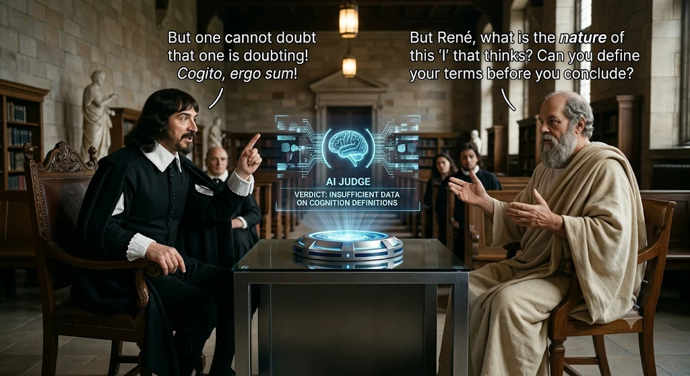

+++
title = 'Descartes, Socrates and AI'
date = 2026-11-15T12:00:00+05:30
# Shown when someone shares a link to this post. It does not appear on the page.
# A JPEG copy, because some sites do not show WebP images in link previews.
images = ["cover-descartes-socrates-ai.jpg"]
+++

René Descartes famously wrote ‘cogito, ergo sum,’ which means ‘I think, therefore I am.’ In another of his works he put it a little differently: ‘I doubt, therefore I am, or what is the same, I think, therefore I am.’

He treated doubting as a form of thinking. Doubting or challenging one’s beliefs and preconceptions is a central idea in Descartes’s work. The idea of methodological skepticism comes from that idea. Methodological skepticism is the systematic process of challenging our beliefs until we find an unshakable truth.

But what unshakable truth are we trying to find? In knowledge work, over time we build mental models of the things we work with. These mental models are built on assumptions of different kinds. We grow comfortable with those assumptions without questioning them.

Descartes offers a way to shake those assumptions loose. He took doubt to the extreme, questioned everything, even simple maths, until he found the one thing he could not doubt: that he himself existed. This degree of skepticism is uncalled for in most practical work. We don’t need to go that far, but his idea of questioning what we take for granted is worth keeping. It exposes how weak our mental models are and gives us a way to improve them.

Questioning is the most important instrument of methodological skepticism. Centuries before Descartes, Socrates asked questions to explore a topic or person. He kept questioning until he reached a conclusion or the reasoning fell apart. We call this the Socratic method, or Socratic debate.

Practicing methodological skepticism using the Socratic method is not easy. Stating your mental models, ideas, understanding, and beliefs is tough. Then, questioning them adds another layer of difficulty. AI comes to the rescue here. It lets you systematically stress test your ideas.

A simple skill like [/socratic-tutor](https://github.com/janestreet/agent_skills/tree/master/socratic-tutor) starts by finding out what you know. Then, it asks questions to explore your understanding. It teaches you when you hit the limits of your knowledge. The massively popular skill [/grill-me](https://github.com/mattpocock/skills/tree/main/skills/productivity/grill-me) asks probing questions about our ideas. It takes a loose idea and interviews us until we are sure of it.

Let AI systematically probe your mental model and stress test it. Then challenge the AI with your ideas and ask for clarifications. In the end, a foundation that was once built on sand will become concrete.
